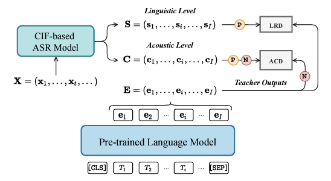

# CIF-HieraDist

<div align="center">

**[INTERSPEECH 2023] Knowledge Transfer from Pre-trained Language Models to CIF-based Speech Recognizers via Hierarchical Distillation**

[](https://www.isca-speech.org/archive/interspeech_2023/han23_interspeech.html)
[](https://github.com/facebookresearch/fairseq)
[](https://www.python.org/)
[](./LICENSE)

</div>

> 🚀 This repository is the **official implementation** of Hierarchical Knowledge Distillation (**HieraDist / HKD**) for Continuous Integrate-and-Fire (**CIF**) based ASR models.

---

## Table of Contents

- [Introduction](#introduction)
- [What Can You Do with This Repository?](#what-can-you-do-with-this-repository)
- [Installation](#installation)
- [Quick Start (AISHELL-1)](#quick-start-aishell-1)
  - [1. Data Preparation](#1-data-preparation)
  - [2. Model Training](#2-model-training)
  - [3. Model Inference](#3-model-inference)
- [Key Results](#key-results)
- [Other Resources](#other-resources)
- [Acknowledgments](#acknowledgments)
- [Citation](#citation)

---

## Introduction

We propose **Hierarchical Knowledge Distillation (HKD / HieraDist)** to transfer knowledge from pre-trained language models (PLMs) to CIF-based ASR models. HieraDist works at two levels:

- **Acoustic level** — cross-modal knowledge distillation with a **token-level contrastive loss** (Acoustic Contrastive Distillation, ACD).
- **Linguistic level** — knowledge distillation with a **regression loss** (Linguistic Regression Distillation, LRD).

Combining both yields the full HieraDist framework.

<div align="center">
  
</div>

📄 For full methodology and analysis, see the paper: [Knowledge Transfer from Pre-trained Language Models to CIF-based Speech Recognizers via Hierarchical Distillation](https://www.isca-speech.org/archive/interspeech_2023/han23_interspeech.html).

---

## What Can You Do with This Repository?

This repo supports four training recipes plus inference:

| # | Capability | Description |
| --- | --- | --- |
| 1 | **CIF (baseline)** | Train a standard CIF-based ASR model |
| 2 | **CIF + ACD** | Add acoustic contrastive distillation |
| 3 | **CIF + LRD** | Add linguistic regression distillation |
| 4 | **CIF + HieraDist** | Full hierarchical distillation (ACD + LRD) |
| 5 | **Inference** | Decode with any trained model |

---

## Installation

> **Prerequisites:** Python `3.7.9` (recommended), a CUDA-capable GPU, and PyTorch installed to match your CUDA version.

```bash
# 1. Clone the repository
git clone https://github.com/MingLunHan/CIF-HieraDist.git
cd CIF-HieraDist

# 2. Install dependencies and the package (editable mode)
pip install -r requirements.txt
pip install -e ./
```

This project is built on [Fairseq](https://github.com/facebookresearch/fairseq); the editable install exposes all custom tasks, models, and criteria.

---

## Quick Start (AISHELL-1)

All examples below use the **AISHELL-1** dataset. First, enter its working directory:

```bash
cd egs/aishell1
```

### 1. Data Preparation

Data preparation follows Fairseq's [speech-to-text](https://github.com/facebookresearch/fairseq/tree/main/examples/speech_to_text) pipeline. You can reuse or adapt our script [`prep_aishell1_data.py`](https://github.com/MingLunHan/CIF-HieraDist/blob/main/examples/speech_to_text/prep_aishell1_data.py) for your own dataset.

```bash
python ../../examples/speech_to_text/prep_aishell1_data.py \
    --input-root ${YOUR_PATH_TO_AISHELL1} \
    --output-root ./data/
```

> **Note:** `${YOUR_PATH_TO_AISHELL1}` should point to the **parent directory** of the AISHELL-1 dataset. Prepared manifests and features will be written to `./data/`.

### 2. Model Training

<details open>
<summary><b>Option A — Standard CIF baseline</b></summary>

```bash
bash run_train_aishell1_cif_small_exp35_14.sh
```
</details>

<details open>
<summary><b>Option B — CIF + HieraDist / HKD</b></summary>

**Step 1.** Extract PLM (e.g., BERT) features:

```bash
bash run_extract_plm_feats.sh
```

> **Note:** Set the path of the generated PLM-feature JSON file in the config under `egs/aishell1/data/`.

**Step 2.** Train the distilled model:

```bash
bash run_train_bert_distilled_cif_exp4_decdistill0p01_noscale_finalstate_contrastiveloss1p0_conttemp0p02_rmvrpt_neg700.sh
```
</details>

> 📁 Original training logs are provided in [`egs/aishell1`](https://github.com/MingLunHan/CIF-HieraDist/tree/main/egs/aishell1) so you can reproduce and compare.

### 3. Model Inference

```bash
bash run_infer.sh
```

> 📁 Original inference logs are also available in [`egs/aishell1`](https://github.com/MingLunHan/CIF-HieraDist/tree/main/egs/aishell1) for reference.

---

## Key Results

Character Error Rate (**CER %**, lower is better) on AISHELL-1. Best results in **bold**.

**Without any external language model:**

| Methods | dev (CER %) | test (CER %) |
| --- | :---: | :---: |
| CIF | 4.5 | 4.9 |
| CIF + ACD | 4.2 | 4.7 |
| CIF + LRD | 4.0 | 4.5 |
| **CIF + HieraDist** | **3.8** | **4.2** *(4.1 with tuned decoding hyper-parameters in later experiments)* |

**With a language model trained on the AISHELL-1 transcripts:**

| Methods | dev (CER %) | test (CER %) |
| --- | :---: | :---: |
| CIF | 4.4 | 4.8 |
| CIF + ACD | 4.2 | 4.6 |
| CIF + LRD | 4.0 | 4.4 |
| **CIF + HieraDist** | **3.8** | **4.1** |

**Takeaway:** ACD and LRD each improve over the CIF baseline, and combining them (HieraDist) yields the largest gain — reducing test CER from **4.9 → 4.2** without an external LM.

---

## Other Resources

- **X-LLM** — The first open-source Chinese Multimodal LLM, and the first work connecting a speech module with an LLM (ChatGLM) in a unified network: [phellonchen/X-LLM](https://github.com/phellonchen/X-LLM) · [MingLunHan/X-LLM-Speech](https://github.com/MingLunHan/X-LLM-Speech)
- **CIF-PyTorch** — A PyTorch implementation of the standalone CIF module: [MingLunHan/CIF-PyTorch](https://github.com/MingLunHan/CIF-PyTorch)
- **CIF-ColDec** — CIF-based Contextualization and Collaborative Decoding: [MingLunHan/CIF-ColDec](https://github.com/MingLunHan/CIF-ColDec)
- **w2v-cif-bert** — CIF as a bridge connecting pre-trained acoustic and language models: [aispeech-lab/w2v-cif-bert](https://github.com/aispeech-lab/w2v-cif-bert)

---

## Acknowledgments

This repository is developed on top of [Fairseq](https://github.com/facebookresearch/fairseq). We thank [Facebook AI Research (FAIR)](https://ai.facebook.com/) for open-sourcing the framework.

---

## Citation

If this work inspires your research or you use the core code from this repository, please cite:

```bibtex
@inproceedings{han23_interspeech,
  author    = {Minglun Han and <tl-view data-tl-origin="Feilong Chen" data-tl-mask="[ph_real_name_6_ph]"></tl-view> and Jing Shi and Shuang Xu and Bo Xu},
  title     = {{Knowledge Transfer from Pre-trained Language Models to CIF-based Speech Recognizers via Hierarchical Distillation}},
  year      = {2023},
  booktitle = {Proc. INTERSPEECH 2023},
  pages     = {1364--1368},
  doi       = {10.21437/Interspeech.2023-423}
}
```

Thanks for your interest! ⭐ If you find this repository helpful, please consider giving it a star.
